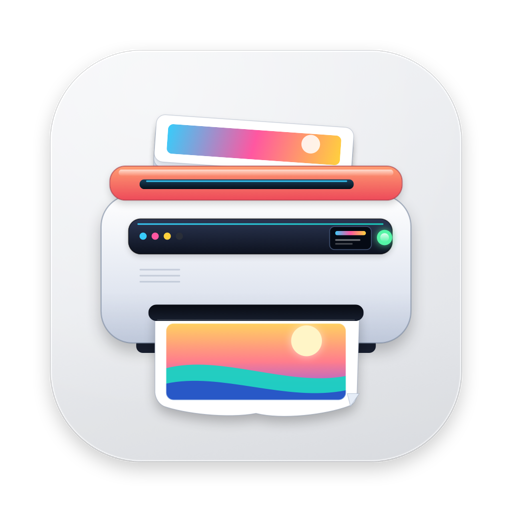

<p align="center">
  
</p>

<h1 align="center">BatchPrint</h1>

<p align="center">
  A small native macOS utility for batch printing: drop in a set of files, choose a printer and print options, review everything once, and send it all to the print queue as a single job.
</p>

## Features

- Drag and drop multiple files, or click to choose them; unsupported or unreadable files are filtered out with a notice
- Supports PDF, common images (PNG, JPEG, TIFF, HEIC, GIF, BMP, WebP), plain text (TXT, MD, CSV, LOG), and RTF
- Choose the printer, single- or double-sided printing (long-edge binding), color or grayscale, and paper size
- Automatically shows the confirmation sheet after the first batch of files is added, with files, page count, and settings
- The drop area collapses once files are added, leaving the file list available for more drops
- Merges every file into one PDF at the selected paper size, then submits it as one print job
- Grayscale mode converts content locally and also requests `monochrome` from CUPS
- Opens files directly from Finder's "Open With" menu
- Compact neutral-gray interface that follows the system light/dark appearance
- English and Simplified Chinese interface, following the system language

## Usage

1. Open `BatchPrint.app`.
2. Drop files onto the dashed area, or click it to choose files. After the first batch, drop more files directly onto the file list.
3. Choose the printer, print mode, color mode, and paper size at the bottom of the window.
4. Check the details in the confirmation sheet and click **Start Printing**.
5. The job appears in the system print queue, and a status toast confirms when it has been submitted.

You can also right-click a file in Finder and choose **Open With → BatchPrint**.

## Requirements

- macOS 13.0 or later
- Intel and Apple Silicon (the build script produces a universal binary)
- At least one configured and enabled printer

## Build

The project uses SwiftUI and AppKit and does not require an Xcode project. `build.sh` compiles arm64 and x86_64 with `swiftc`, combines them with `lipo`, and assembles the `.app` bundle:

```sh
./build.sh
open BatchPrint.app
```

Build output:

- `BatchPrint.app` — the runnable application
- `.build/manual/` — intermediate build products (safe to delete)

> SwiftPM cannot initialize correctly in the current environment (`swift build` reports a property list parsing error), so use the direct compilation flow in `build.sh` instead of `swift build`.

## Localization

The interface ships with English and Simplified Chinese resources:

- English is the development language and the source of the string keys in code.
- `Resources/zh-Hans.lproj/Localizable.strings` contains the Simplified Chinese translations.
- `Resources/zh-Hans.lproj/InfoPlist.strings` localizes the app name to **批量打印**; `Resources/en.lproj/InfoPlist.strings` keeps it as **BatchPrint**.
- The app follows the system's preferred language list and falls back to English when Chinese is not preferred.

To force a language for testing:

```sh
open BatchPrint.app --args -AppleLanguages '(zh-Hans)'
```

## Implementation notes

- **Printer list**: enumerates only configured queues through libcups `cupsGetDests`; the UI shows friendly names while jobs use the real CUPS queue name.
- **Job submission**: submits CUPS jobs through `/usr/bin/lp` with explicit `media`, `sides`, `print-color-mode`, and job name.
- **PDF merging**: creates a PDF at the target paper size with Core Graphics and draws PDF pages, images, and text in order.
- **Grayscale**: applies the system `/System/Library/Filters/Gray Tone.qfilter` to the PDF context through Quartz so vector content is converted as well.
- **Page counts**: PDFs report their real page count; text page counts are unknown until merging, so the confirmation sheet's total may exclude text files.
- **Single window**: uses SwiftUI's `Window(id:)` so opening files from Finder does not create extra main windows.
- **App icon**: generated by `Scripts/generate_icon.swift`; the in-app mark uses a light-gray tile with a graphite printer and a CMYK paper strip.

## Known limitations

- The app is ad-hoc signed and not notarized by Apple. When copied to another Mac, the first launch may require approval in **System Settings › Privacy & Security**.
- Actual print options depend on the selected printer driver. CUPS may reject a job if the printer does not support the chosen paper size or duplex mode.
- One paper size and one copy (fixed at 1) apply to the whole batch; page ranges, per-file settings, and print previews are not supported.
- All files are submitted as a single print job instead of being queued one by one.

## Project layout

```
Sources/BatchPrint/
  BatchPrintApp.swift    App entry point, Finder file opening, window positioning
  ContentView.swift      Main UI, drop area, file list, settings, and status
  ConfirmationView.swift Print confirmation sheet
  PrintViewModel.swift   File inspection, printer list, confirmation, and printing flow
  PrintService.swift     PDF merging, grayscale conversion, CUPS submission
  Models.swift           Print options, file kinds, and paper mappings
  Theme.swift            Colors and shared UI components
  Localization.swift     Localization helpers for dynamic strings
Resources/
  AppIcon.icns           Application icon
  AppIcon.png            Icon used in this README
  en.lproj/              English app metadata
  zh-Hans.lproj/         Simplified Chinese interface and app metadata
Scripts/generate_icon.swift Icon generator
Samples/                 Sample files for testing
Info.plist               Application metadata
build.sh                 Universal binary build script
```
